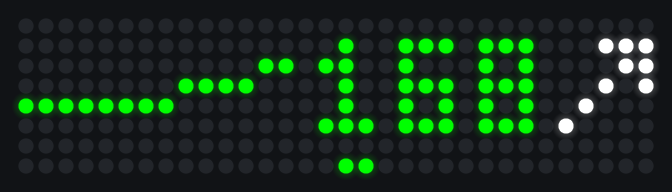
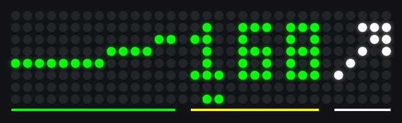
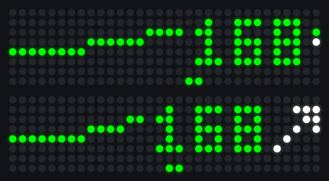
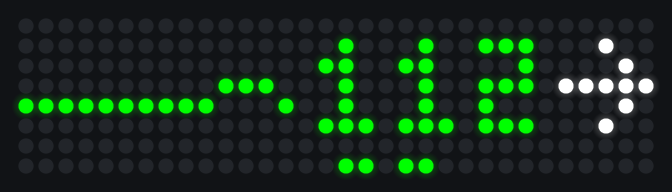
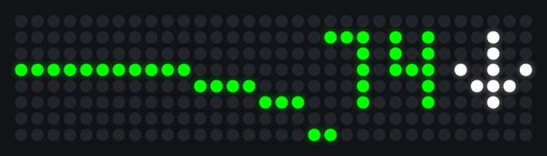
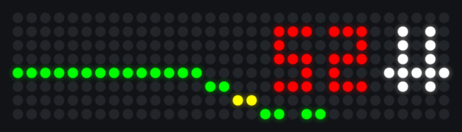
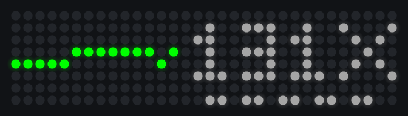

# Graph, value and arrow face

A clock face for Nightscout Clock on the Ulanzi TC001. It shows a glucose graph, the current value and the trend arrow together on the 32 × 8 display.

**[Open the interactive preview](https://claude.ai/artifact/RaZojfXw5Qzmf7jxABbBFC)**, which compares it with the built-in face and lets you try the graph span setting. To view it offline, download [`preview.html`](preview.html) and open it in a browser.

## What it shows

| Zone | Columns | What it shows |
|---|---|---|
| Graph (green bar) | 0–13 with a 3-digit value, 0–17 with 2 digits | Recent readings, newest on the right, one row per range band like the built-in graph faces |
| Value (yellow bar) | up to the column before the arrow | The latest reading in its range color: green in range, yellow low or high, red urgent |
| Arrow (white bar) | 27–31 | The 5 × 5 trend arrow, or a cross when the reading is too old |
| Bottom row, under the value | | One dot per minute since the last reading, up to five |

### Compared with the built-in "Graph and BG" face

The built-in face (top) shows the trend as a one-column colored bar. This face (bottom) shows the same arrow as the Simple face, so the trend reads at a glance across a room. The cost is 4 graph columns.

### More examples

| Steady | Dropping | Urgent low | Reading too old |
|---|---|---|---|
|  |  |  |  |

## Setting

On the settings page, under **Clock faces**, the face has a **Graph span** setting of **1, 2 or 3 hours** (default 2). Each graph column averages the readings in its share of the span. A column never covers less than 5 minutes, so a short span never leaves gaps between Dexcom readings. With a 3-digit value, 1 hour shows 70 minutes.

## Installing

This face is on the `graph-arrow-face` branch of this fork and not in an official Nightscout Clock release, so it has to be built and flashed over USB:

1. Set up PlatformIO as described in [CONTRIBUTING.md](../../CONTRIBUTING.md).
2. Check out this branch, then build and flash the firmware and the file system (`scripts/build.sh --all --upload`). Flashing replaces your settings, so save a backup under **WiFi & system → Backup and restore** first and restore it afterwards.
3. In the settings, turn on **Graph, value and arrow** under **Clock faces** and pick it as the default face if you like.

## Hardware

The [Ulanzi TC001 Smart Pixel Clock](https://www.amazon.com/dp/B0CXX91TY5) (about $42). Back up its original firmware before replacing it, as described in the main README.

## Images

The pictures on this page are drawn by [`render_png.mjs`](render_png.mjs) with the drawing code of `preview.html`, which follows the firmware's font, arrows, colors and graph rows. To redraw them after changing the preview, run `node docs/graph-arrow-face/render_png.mjs docs/graph-arrow-face/preview.html docs/graph-arrow-face` (macOS).

---

Nightscout Clock is a hobby project, not a medical device. Keep using your Dexcom app and its alarms. This face is not affiliated with Dexcom or Ulanzi.
